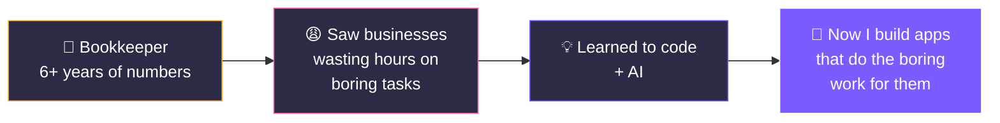

<p align="center">
  
</p>

<p align="center">
  <a href="mailto:himanshubashambu08@gmail.com"></a>
  <a href="https://www.instagram.com/himanshubashmbu"></a>
</p>

```bash
$ whoami
> Himanshu — I build AI apps & robots-in-the-cloud for small businesses 🤖

$ cat superpowers.txt
> 6+ years of bookkeeping 📒  +  AI 🤖  =  apps that actually save money 💰

$ cat languages.txt
> English · हिंदी · ਪੰਜਾਬੀ · TypeScript · Python

$ status
> 🟢 Open to work, collabs, and cool ideas
```

## 🎬 The Plot Twist



---

## 🌌 The App Universe

> Every app here started with a real problem. Here's each one in plain words: **the problem 😩 → the magic ✨ → why it matters 🏆**

<table>
<tr>
<td width="50%" valign="top">

### 🥗 PrepMate
**Your personal AI chef & grocery planner**

😩 *"What do I cook this week?"* — every week, plus wasted food and money.

✨ Tell it what you like, your budget and your time. It plans your whole week, gives you recipes and writes your grocery list. Snap a photo of your bill and it remembers what's in your kitchen.

🏆 Saves time, money **and** food.

`React` `OpenAI` `Stripe` `PostgreSQL` `Mobile app`

</td>
<td width="50%" valign="top">

### ⛽ Fuel Receipts
**Never lose a gas receipt (or tax money) again**

😩 People who drive for work lose paper receipts and miss tax refunds.

✨ Take a photo of the receipt. AI reads the date, litres, price and tax for you. At year end it tells you how much you can claim and makes a report for your accountant.

🏆 Every receipt safe on your phone, even offline.

[**👉 Try it live**](https://himanshubashambu08-star.github.io/himanshubashambu08/) · [Code](./petrol-receipts)

`Firebase` `Gemini AI` `Works offline`

</td>
</tr>
<tr>
<td width="50%" valign="top">

### 🇫🇷 FluentFast B2
**A French teacher with a face, a voice and endless patience**

😩 Learning French is slow, and apps don't tell you *why* you sound wrong.

✨ An animated AI teacher listens to you speak, checks your pronunciation and grammar, and tells you how to fix it. Smart flashcards come back right before you forget.

🏆 From zero to confident French (B2) in about 90 days.

`React` `OpenAI voice` `PostgreSQL`

</td>
<td width="50%" valign="top">

### 🚚 Trucking POD Manager
**No more chasing drivers for paperwork**

😩 Trucking companies can't get paid without delivery papers — and the papers go missing.

✨ Drivers snap a photo of the delivery paper on their phone. The office sees every paper in one place and emails it to the broker in one click.

🏆 Faster paperwork = faster payment.

`React` `Express` `PostgreSQL` `Multi-company`

</td>
</tr>
<tr>
<td width="50%" valign="top">

### 🎬 SaaS Video Marketer
**Paste a link, get an ad video**

😩 Small software companies can't afford video editors.

✨ Paste any website link. AI looks at the site, writes a short ad script, and creates a ready-to-post 30-second video with voice and music — in 5 different styles.

🏆 A marketing video in minutes, not weeks.

`Claude AI` `Puppeteer` `FFmpeg`

</td>
<td width="50%" valign="top">

### 📈 AI Crypto Dashboard
**A trading desk without the risk**

😩 Testing trading ideas with real money is scary.

✨ Live Bitcoin, Ethereum and Solana prices on pro charts. Test a strategy on past prices and get an AI *buy / sell / wait* signal.

🏆 Learn and test before you risk a single dollar.

`WebSockets` `Binance API` `TradingView charts`

</td>
</tr>
<tr>
<td width="50%" valign="top">

### 📬 AI Outreach Agent
**A sales assistant that never sleeps**

😩 Finding new clients by hand takes hours every day.

✨ Every day it finds small businesses, checks their websites for problems, finds their email and writes a personal message. I just read, tweak and click send.

🏆 Hours of research → 5 minutes of approving.

`Mastra AI agents` `OpenAI` `Gmail`

</td>
<td width="50%" valign="top">

### 💼 LinkedIn Outreach Bot
**Networking on autopilot (the polite kind)**

😩 Writing personal LinkedIn messages one by one is exhausting.

✨ Finds people who might need a website or automation, writes a personal message for each, and reminds me to follow up on day 1, 3 and 7.

🏆 More conversations, less typing.

`Mastra AI agents` `GPT-4o` `PostgreSQL`

</td>
</tr>
<tr>
<td width="50%" valign="top">

### 📞 Stella — AI Receptionist
**The receptionist who never takes a break**

😩 Busy shops miss calls — and every missed call is a lost customer.

✨ An AI voice answers the phone, chats like a real person, and books the appointment straight into Google Calendar. 24/7.

🏆 Zero missed calls. Zero extra staff.

`Vapi voice AI` `Make.com` `Google Calendar`

</td>
<td width="50%" valign="top">

### 💰 FinanceAuthority
**Money advice without the confusing words**

😩 Finance websites are full of jargon.

✨ Simple guides on credit cards, loans, insurance, investing and credit scores, with easy comparison tables.

🏆 Honest money tips for people — earns from ads for me.

`React` `TypeScript` `SEO`

</td>
</tr>
</table>

<details>
<summary><b>🎨 Bonus: my portfolio websites (click to open)</b></summary>
<br/>

| Website | What it is |
|---|---|
| 🎥 **Cinematic Portfolio** | My work shown like a movie trailer — dark, gold and dramatic |
| 🌆 **3D Portfolio** | Scroll through a glowing 3D city to see my projects |
| ⚡ **My Creative Showcase · Automation Architect · Automation Alchemy** | One-page sites that explain my AI services and let you book a call |

</details>

<details>
<summary><b>🛒 Bonus: my business side-quests (click to open)</b></summary>
<br/>

- 🐶 **PawfectLife** — an online store for pet grooming products
- 🍚 **Rice import** — bringing Basmati rice from Indian farms to Canadian grocery shelves
- 🏸 **Skyboo** — a brand-new outdoor sports game I'm inventing

</details>

---

## 🧭 Which app is for you?

| If you... | Try this |
|---|---|
| 🍳 never know what to cook | **PrepMate** |
| ⛽ drive for work and pay taxes | **Fuel Receipts** |
| 🥐 want to speak French | **FluentFast B2** |
| 🚛 run a trucking company | **Trucking POD Manager** |
| 📞 miss phone calls at your business | **Stella** |
| 🎥 need a promo video for your software | **SaaS Video Marketer** |

---

## 🧰 My Toolbox

<p align="center">
  
</p>

<p align="center">
  
  
  
  
  
  
  
  
  
</p>

---

## 📊 GitHub Stats

<p align="center">
  
  
</p>
<p align="center">
  
</p>

---

<p align="center">
  <b>💬 Got a boring task that eats your day? Let's turn it into an app.</b><br/>
  <sub>Made with ☕, chai and a lot of AI · London, Ontario 🇨🇦</sub>
</p>
