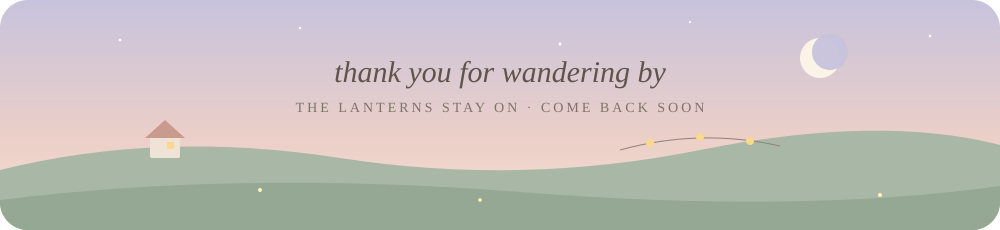

  

<i>
Hello, traveller. Take your shoes off, the grass is soft here. 
I'm <b>Himanshu</b> — I spent six years keeping other people's books balanced, 
and now I build small, quiet apps that do the boring work so people don't have to.
</i>

  ✉️ <a href="mailto:himanshubashambu08@gmail.com">write me a letter</a> &nbsp;·&nbsp; 📷 <a href="https://www.instagram.com/himanshubashmbu">say hi on instagram</a> &nbsp;·&nbsp; 📍 London, Ontario

 

  

 

## 🧺 The places, one by one

<i>Each place on the map is an app. Here's what happens inside, in plain words.</i>

<table>
<tr>
<td width="50%" valign="top">

#### 🏡 The Kitchen Garden
<b>PrepMate</b>

Every week the same question: *"what do we cook?"* Here, you just say what you like, how much you want to spend and how busy you are. The garden plans your whole week, hands you the recipes and writes your grocery list. Show it a photo of your shopping bill and it remembers what's already in your kitchen.

*Why it exists:* less wasted food, less wasted money, more quiet evenings.

made with React · OpenAI · Stripe

</td>
<td width="50%" valign="top">

#### ⛽ The Old Fuel Stop
<b>Fuel Receipts</b> · <a href="https://himanshubashambu08-star.github.io/himanshubashambu08/">step inside →</a>

Paper receipts fade and get lost in car doors. Here, you take a photo and the app reads the date, litres, price and tax for you. When tax season comes, it tells you what you can claim and makes a neat report for your accountant.

*Why it exists:* people who drive for work deserve every dollar they're owed.

made with Firebase · Gemini · works offline · <a href="./petrol-receipts">see the code</a>

</td>
</tr>
<tr>
<td width="50%" valign="top">

#### 🥐 Little Paris Café
<b>FluentFast B2</b>

A small café where a kind French teacher with a drawn face listens to you speak. It gently tells you which sounds and words need a little work, and brings old words back right before you forget them.

*Why it exists:* to help English speakers reach confident French in about 90 days.

made with React · OpenAI voice

</td>
<td width="50%" valign="top">

#### 🚚 The Truck Yard
<b>Trucking POD Manager</b>

Drivers come back from long roads with delivery papers in their pockets. Here, they snap a photo on their phone, and the office finds every paper in one tidy place, ready to send to the broker in one click.

*Why it exists:* no paper, no payment — so the paper should never get lost.

made with React · Express · PostgreSQL

</td>
</tr>
<tr>
<td width="50%" valign="top">

#### 💡 The Lighthouse
<b>Stella · AI receptionist</b>

The light that never goes out. When a small shop is too busy to pick up the phone, Stella answers, talks kindly like a real person, and books the appointment straight into the calendar — day or night.

*Why it exists:* every missed call is a customer who walked away.

made with Vapi voice · Make.com · Google Calendar

</td>
<td width="50%" valign="top">

#### 📮 The Post Office
<b>AI Outreach Agent</b>

Every morning, the postman goes out and finds small businesses that might need help, looks at their websites, and drafts a warm, personal letter for each one. I read every letter before it leaves.

*Why it exists:* finding new people to help shouldn't take the whole day.

made with Mastra · OpenAI · Gmail

</td>
</tr>
<tr>
<td width="50%" valign="top">

#### ⛲ The Town Square
<b>LinkedIn Outreach</b>

Where new friendships begin. It finds people who might need a website or a little automation, helps write a thoughtful first hello, and reminds me to check in on day 1, 3 and 7.

*Why it exists:* good conversations, without hours of typing.

made with Mastra · GPT-4o · PostgreSQL

</td>
<td width="50%" valign="top">

#### 🎞️ The Little Cinema
<b>SaaS Video Marketer</b>

Hand it the address of any website. It looks around, writes a short story about it, and plays a 30-second film with a voice and soft music — ready to share.

*Why it exists:* small teams can't always afford a video maker.

made with Claude · Puppeteer · FFmpeg

</td>
</tr>
<tr>
<td width="50%" valign="top">

#### 🗼 The Market Tower
<b>Crypto Dashboard</b>

From the top of the tower you can watch Bitcoin, Ethereum and Solana prices move in real time, test an idea on yesterday's prices, and get a calm *buy, sell or wait* suggestion.

*Why it exists:* to learn and practise without risking real money.

made with WebSockets · TradingView charts

</td>
<td width="50%" valign="top">

#### 📚 The Quiet Library
<b>FinanceAuthority</b>

Shelves of simple, honest guides about credit cards, loans, insurance, investing and credit scores — written without the confusing words.

*Why it exists:* money advice should feel like a friend explaining, not a bank talking.

made with React · TypeScript

</td>
</tr>
</table>

 

## 📖 The traveller who built it

For six years I was a bookkeeper. I kept the numbers tidy for more than fifty clients, and I watched good, hardworking people lose hours every week to the same small, boring tasks.

So I learned to build. Slowly at first, then every day.

Now I make little helpers for small businesses — voices that answer the phone, gardens that plan your meals, post offices that write your letters. Nothing loud. Just things that quietly make the day lighter.

<i>I speak English, हिंदी and ਪੰਜਾਬੀ, and I'm always happy to talk about an idea over chai.</i>

 

## 🎒 In my backpack

<b>for building</b> — TypeScript · JavaScript · Python · React · Node.js · Express · Next.js · Tailwind · Three.js 
<b>for thinking</b> — OpenAI · Claude · Gemini · Mastra agents 
<b>for talking & connecting</b> — Vapi voice · Make.com · Google Calendar · Gmail 
<b>for keeping things safe</b> — PostgreSQL · Supabase · Firebase 
<b>for the shop</b> — Stripe · Shopify · QuickBooks · Xero

  

<b>🌙 Beyond the edge of the map</b> (click to unfold)

 

**Houses where I keep my portfolio**
- 🎥 *The Cinematic House* — my work, shown like an old movie: dark, golden and slow
- 🌆 *The Glowing City* — a little 3D town you scroll through
- 🕯️ *Three small cottages* (My Creative Showcase · Automation Architect · Automation Alchemy) — where you can read about my work and book a call

**Roads I'm still walking**
- 🐶 **PawfectLife** — a small shop for gentle pet-grooming products
- 🍚 **Rice import** — carrying Basmati from Indian farms to Canadian kitchens
- 🏸 **Skyboo** — a new outdoor game, still being invented

 

## 👣 Footprints

  
  

 

  

